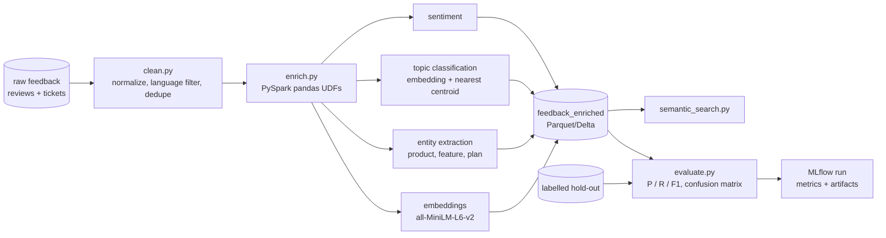

# customer-feedback-nlp-pipeline

 

Batch NLP enrichment of product reviews and support tickets into model-ready tables, with an MLflow evaluation harness that reports precision, recall and F1 per label and supports error analysis. Small CPU models only.

> Fictional company: **Bluebonnet Software**. Reviews and tickets are synthetic, generated from templates with a labelled hold-out set.

## Architecture


## Run it in three commands
```bash
make setup   # venv + deps (CPU torch) and model download (~90 MB)
make demo    # generate 5k records, enrich, evaluate, open MLflow UI on :5000
make test    # pytest on cleaning, UDF contracts, metric calculations
```

## What it proves
- NLP as a data-engineering job: batch inference inside Spark, idempotent outputs, typed schemas
- Evaluation discipline: a labelled set, per-class metrics and error analysis logged to MLflow
- Model-ready tables designed for downstream analytics and search

## Limitations
- Synthetic text is easier than real feedback, so the metrics demonstrate method, not real-world accuracy.
- Uses pretrained models only; no fine-tuning. Sentiment is a lexicon scorer, and topics are nearest-centroid over embeddings of a small labelled seed set (`data/seeds/topic_seeds.csv`).
- all-MiniLM-L6-v2 is used only when `USE_ST_MODEL=1` and the model can be downloaded; otherwise (and always in tests and CI) a deterministic hashing embedder stands in, so the reported metrics reflect that fallback. `make setup` treats the torch/model download as best effort.
- The enriched table is written as Parquet (partitioned by source); Delta is not used locally.
- The Spark engine needs Java 17 (Spark 3.5 Arrow UDFs fail on Java 21); `ENRICH_ENGINE=pandas` runs the same functions without a JVM.

## About the author
Built by Gopi Dodda, Senior Data Engineer: [LinkedIn](https://www.linkedin.com/in/gopidodda6091/). Original work on synthetic data.
